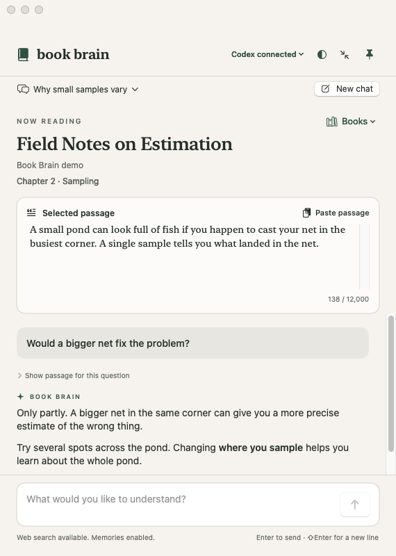

# Book Brain

Select a passage in Kindle for Mac, press **⌘⇧B**, and ask a question in a floating window beside the book. Each book keeps its own conversations, so you can return to a question when you pick up reading again. If you have a PDF, attach it when adding the book and ask Codex to point you to the page behind an answer.

<p align="center">
  
  <br>
  <em>The reading window with a fictional passage and sample conversation.</em>
</p>

## Build and run on your Mac

You'll need macOS 14 or later, Xcode 16 or later with Swift 6, and an authenticated Codex CLI with app-server permission profiles. Book Brain was tested with CLI version `0.167.0-alpha.3.2`. Check your version with `codex --version`. If you need to sign in, run `codex login`. [Codex CLI setup](https://github.com/openai/codex#quickstart)

```bash
git clone https://github.com/ubiratanfilho/book-brain.git
cd book-brain
./scripts/build-app.sh
open "build/Book Brain.app"
```

The first build downloads the Swift package dependencies. The script creates an ad hoc signed app for your Mac's architecture. If Book Brain can't find Codex, choose **Locate Codex executable…** in the connection menu.

## Try it with a book

1. Choose **Add book** and enter the title and author. If you'd like Codex to consult a PDF, choose **Attach PDF (optional)…** before saving.
2. Click **Enable Kindle capture…** and grant the macOS permission. In Kindle for Mac, select a paragraph you can copy and press **⌘⇧B**. Book Brain shows the passage for review. For manual capture, copy the passage yourself and click **Paste passage**.
3. Try asking *“Can you explain this with an example?”* Press **Enter** to send. Ask a follow-up in the same chat, or click its title later to reopen a conversation for that book. Codex answers in the language of your question.

## What gets shared

Book Brain saves your library, drafts and imported PDFs on your Mac. When you send a question, Codex receives the book title, author, reading reference, selected passage and question. If Codex consults an attached PDF, it receives the requested excerpts or page images. Your Codex account's usage limits apply. Web search and Codex memory are enabled for these chats. [Storage, permissions and troubleshooting](docs/reading-guide.md)

## Development

The app uses SwiftUI and AppKit. Run the offline test suite with synthetic passages and a simulated Codex server, then build the app bundle.

```bash
swift test
./scripts/build-app.sh
```

To run the optional integration tests against your authenticated Codex session, use `BOOK_BRAIN_LIVE_TEST=1 swift test`. These tests use synthetic text and PDFs. [Codex integration details](docs/reading-guide.md#codex-integration)

Format Swift with `swift format format --in-place --recursive Sources Tests Package.swift` and the Python fixture with `python3 -m black Tests/BookBrainCoreTests/Fixtures/fake-codex.py`.

## License

Book Brain is available under the [MIT License](LICENSE). The app bundle includes license notices for MarkdownUI, NetworkImage and swift-cmark. Book Brain is an independent project by Ubiratan da Motta and has no affiliation with Amazon or OpenAI.
